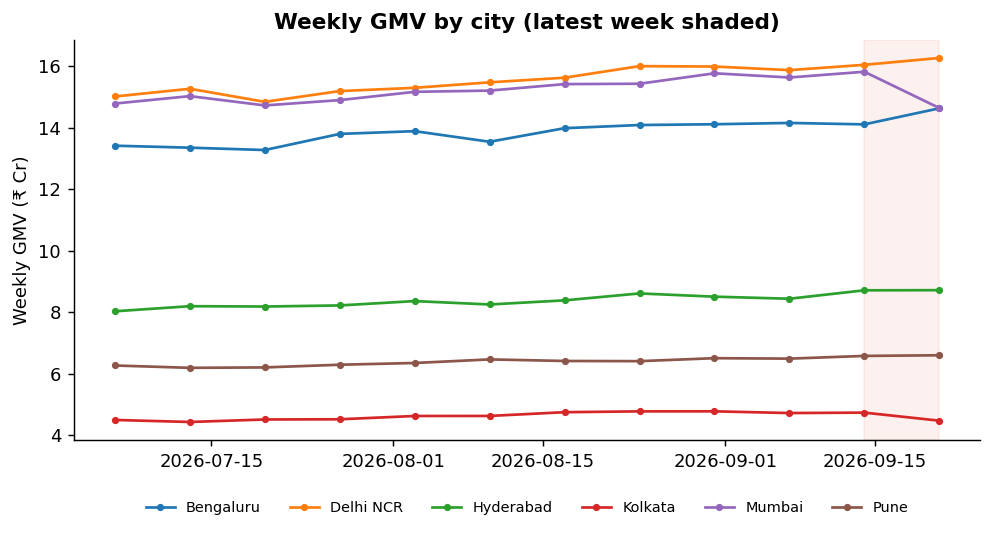
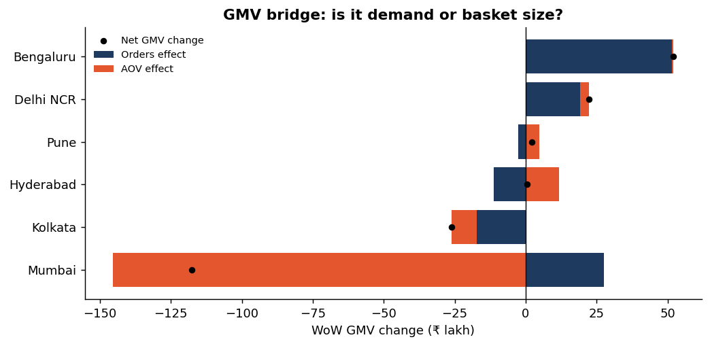
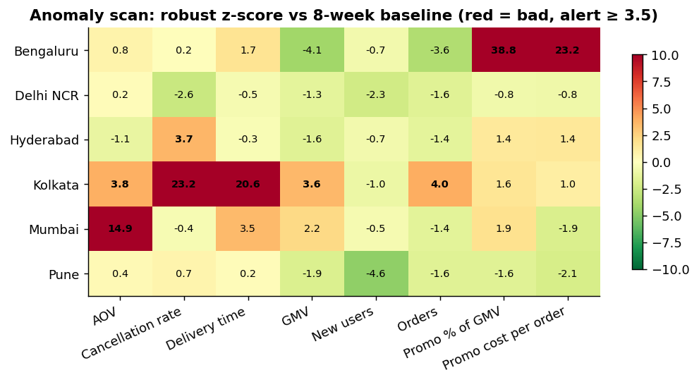

# Weekly Business Review: week of 21 Sep 2026

_Narrative by: `rules` narrator · every number is traced back to the KPI engine._

| KPI | This week | WoW | vs 4-wk avg |
|---|---|---|---|
| GMV | ₹65.32 Cr | -1.0% | -0.4% |
| Orders | 1,617,493 | +0.9% | +1.9% |
| AOV | ₹404 | -1.9% | -2.2% |
| Cancellation rate | 4.4% | +10.2% | +10.5% |
| Promo % of GMV | 10.4% | +11.3% | +12.6% |
| New users | 101,945 | +0.2% | +2.0% |

## Narrative

**Headline:** GMV ₹65.32 Cr (-1.0% WoW), orders 1,617,493 (+0.9%), AOV ₹404 (-1.9%).

**Top issues**
1. **Mumbai – AOV** fell to ₹416 vs ₹457 baseline (-8.9%, impact -₹1.45 Cr / week). Orders moved +1.8% WoW, so this is a basket-size issue, not demand. AOV effect on GMV: -₹1.45 Cr. → *Category: audit menu pricing, combo availability and top-merchant basket mix*
2. **Bengaluru – Promo % of GMV** rose to 13.8% vs 8.8% baseline (+55.6%, impact -₹77.0 L / week). Orders only +3.7% WoW against much higher spend, so the incremental orders are expensive. → *Growth: set a promo-as-%-of-GMV guardrail and review the campaign calendar*
3. **Kolkata – Cancellation rate** rose to 9.2% vs 3.9% baseline (+135.0%, impact -₹26.1 L / week). Delivered orders -3.7% WoW, GMV impact -₹26.1 L. Moving together with delivery time (+19.8%), which points to a supply-side ops incident. → *Ops: check rider supply and restaurant acceptance by zone, daily war-room until back to baseline*

**GMV bridge (WoW)**
- Mumbai: -₹1.18 Cr (orders +₹27.7 L, AOV -₹1.45 Cr)
- Kolkata: -₹26.1 L (orders -₹17.3 L, AOV -₹8.8 L)
- Hyderabad: +₹45,308 (orders -₹11.3 L, AOV +₹11.8 L)
- Pune: +₹2.1 L (orders -₹2.7 L, AOV +₹4.7 L)
- Delhi NCR: +₹22.3 L (orders +₹19.1 L, AOV +₹3.2 L)
- Bengaluru: +₹52.1 L (orders +₹51.5 L, AOV +₹61,336)

## Charts

